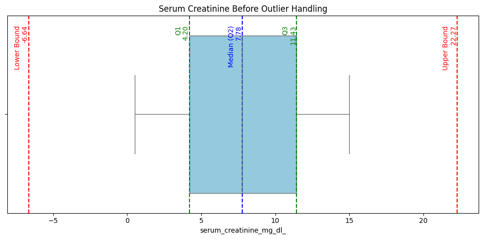
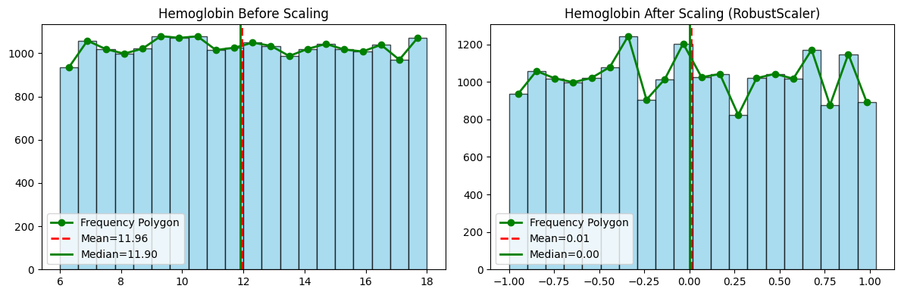
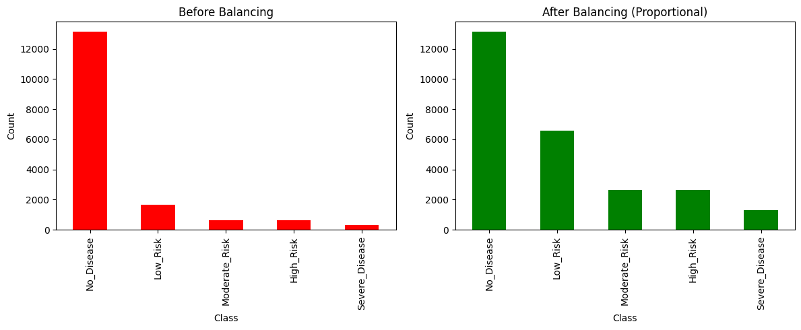

# Kidney Disease Prediction – Data Preprocessing Pipeline

A machine-learning project to support **early diagnosis of kidney disease** from routine clinical
data. This repository contains the team's **end-to-end data preprocessing pipeline**: cleaning,
encoding, outlier handling, scaling, feature engineering and class balancing. It turns raw
patient records into a model-ready dataset and checks the result with a baseline classifier.

> SLIIT · Year 2 Semester 1 · Machine Learning (MLB) group project · Group 2025-Y2-S1-MLB-WE3G1-04

---

## At a glance

| | |
|---|---|
| **Problem** | Predict a patient's kidney disease risk level from clinical measurements |
| **Task** | Multi-class classification (5 classes) |
| **Dataset** | Kidney Disease Dataset (Kaggle) · **20,538 patients** · 42 clinical attributes + target |
| **Stack** | Python · pandas · scikit-learn · imbalanced-learn · matplotlib · seaborn · Jupyter |

### Target classes

| Class | Patients | Share |
|---|---:|---:|
| No_Disease | 16,432 | 80.0% |
| Low_Risk | 2,054 | 10.0% |
| Moderate_Risk | 821 | 4.0% |
| High_Risk | 821 | 4.0% |
| Severe_Disease | 410 | 2.0% |

The data is **heavily imbalanced**: 80% of patients have no disease. Handling that was a key part
of the pipeline.

---

## Pipeline

```
 Raw CSV (20,538 × 43)
   │
   ├─ 1. Select features       → 36 clinically relevant attributes + target
   ├─ 2. Missing values         → median (numeric) / mode (categorical), drop duplicates
   ├─ 3. Categorical encoding   → label encoding (binary) + one-hot encoding (multi-category)
   ├─ 4. Outlier handling       → IQR capping (1.5 × IQR) on every numeric column
   ├─ 5. Scaling                → RobustScaler (resistant to remaining outliers)
   ├─ 6. Feature engineering    → new BMI-category and age-group features
   └─ 7. Split & balance        → stratified 80/20 split + proportional oversampling (train only)
   │
 Model-ready data (38 features) → baseline Logistic Regression
```

| Step | What we did | Why |
|---|---|---|
| **1. Feature selection** | Kept 36 clinical attributes: blood pressure, serum creatinine, eGFR, haemoglobin, blood urea, cystatin C, CRP, IL-6, comorbidities (hypertension, diabetes, anaemia, CAD) and more | Drop columns that don't help prediction |
| **2. Missing values & cleaning** | Checked every column (no missing values in this version of the data); median / mode imputation built in for numeric / categorical gaps; duplicate rows removed | Keeps the pipeline safe for new or messier data; the median is robust to skewed lab values |
| **3. Categorical encoding** | **Label encoding** for yes/no fields, **one-hot encoding** for multi-category fields | Models need numeric input without a false ordering |
| **4. Outlier handling** | Values capped at **Q1 − 1.5·IQR** and **Q3 + 1.5·IQR** | Reduces the influence of extreme readings without deleting patients |
| **5. Scaling** | **RobustScaler** (median and IQR) | Puts features on a comparable scale and is less sensitive to outliers than standard scaling |
| **6. Feature engineering** | Added `bmi_cat` (Under / Normal / Over / Obese) and `age_group` (Young / Adult / Mid / Elder) | Captures clinically meaningful groupings |
| **7. Split & class balancing** | Stratified 80/20 train-test split, then **RandomOverSampler** with a proportional strategy so that all disease classes together match No_Disease, keeping their relative ratios | Fixes the imbalance **only on training data**, with no leakage into the test set |

### Visuals

**Outlier handling**: serum creatinine with quartiles and IQR bounds



**Scaling**: haemoglobin before and after RobustScaler



**Class balancing**: training-set classes before and after proportional oversampling



---

## Baseline check

After preprocessing, a **multinomial Logistic Regression** was trained on the balanced training
set and evaluated on the untouched test set (4,108 patients) to confirm the pipeline produces
valid, model-ready data.

| Metric | Result |
|---|---|
| Accuracy | 0.80 |
| Macro F1 | 0.18 |

The linear baseline predicts only the majority class (`No_Disease`), so its 80% accuracy simply
mirrors the class imbalance. This is a **sanity check, not a final model**. It shows why
**macro-F1** is the right metric here and why non-linear models (tree ensembles, gradient
boosting) are the natural next step.

---

## Repository structure

```
├── notebooks/notebooks/notebooks/
│   ├── group_pipeline.ipynb                                   ← full pipeline (all steps)
│   ├── IT24103675_Missing_Values_&_Cleaning.ipynb
│   ├── IT24103756_categorial_Encoding.ipynb
│   ├── IT24102895_outlier_Handling.ipynb
│   ├── IT24103054_scaling_&_normalization.ipynb
│   ├── IT24103236_Feature_Engineering_&_Selection.ipynb
│   └── IT24103630_Data_Splitting_&_Class_Imblance_Handling.ipynb
├── data/
│   ├── raw/          ← place the dataset CSV here
│   └── external/
├── images/           ← charts used in this README
└── README.md
```

## How to run

1. **Get the data.** Download the *Kidney Disease Dataset* from Kaggle and save it as
   `data/raw/kidney_disease_dataset.csv`.
2. **Install the dependencies.**
   ```bash
   pip install pandas numpy scikit-learn imbalanced-learn matplotlib seaborn jupyter
   ```
3. **Point the notebooks at the data.** In each notebook, change the `pd.read_csv(...)` path to
   `data/raw/kidney_disease_dataset.csv`. The notebooks currently use a local Windows path.
4. **Run.** Open `notebooks/notebooks/notebooks/group_pipeline.ipynb` in Jupyter and choose
   **Run All**. Each individual notebook can also be run on its own to explore one technique.

---

## Team

| IT Number | Name | Responsibility |
|---|---|---|
| IT24103675 | **Bandara H.M.T.A** | Missing values & cleaning |
| IT24103756 | Jayawardana D.I.A | Categorical encoding |
| IT24102895 | Kalubowila D.N.D | Outlier handling |
| IT24103054 | Fahad M.H.M. | Scaling & normalisation |
| IT24103236 | Saadh M.Z.M | Feature engineering & selection |
| IT24103630 | Bulathsinghala B.V.K.A | Data splitting & class imbalance handling |

---

**Adithya Bandara**: [Portfolio](https://adirc7.github.io) · [LinkedIn](https://www.linkedin.com/in/adithya-bandara-3808192b2) · [GitHub](https://github.com/Adirc7)
